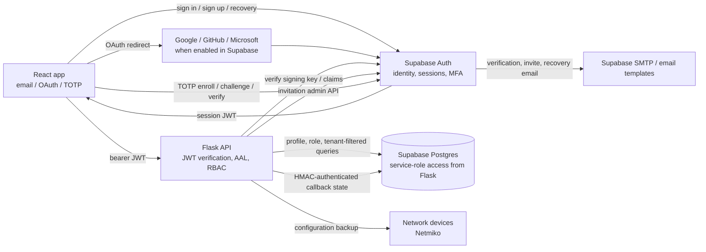

# NetOps360 Authentication Security Test Report

**Review date:** 2026-11-28  
**Scope:** Company registration/onboarding, Supabase Auth integration, Flask JWT/RBAC, invitations, MFA/session controls, tenant data scoping, and database migrations.  
**Disposition:** **Not production ready.** Local checks pass, but the live database/Auth configuration and tenant isolation have not been verified against an active NetOps360 Supabase project.

## Architecture reviewed

Flask is the application data boundary. Postgres migrations enable RLS and revoke table privileges from `anon` and `authenticated`; the backend uses a service-role client and adds tenant predicates in repository queries. This arrangement is safe only while every user-facing repository path and every background worker applies the correct company ownership rule. Supabase's MFA assurance level is enforced in Flask for privileged roles; enrollment/challenge calls are made by the frontend.

## Results and evidence

### Repository checks

| Check | Result | Evidence / limit |
|---|---|---|
| Backend automated tests | **158 passed, 5 skipped** | In-memory repository and mocks; skipped integration cases require live Supabase. Includes the cross-company rule regression test. |
| Frontend automated tests | **2 passed, 0 failed** | Node test runner; validates auth-flow and API contracts, not live provider redirects. |
| Frontend production build | **Passed** | Vite compile only; emits a >500 kB JavaScript chunk warning. Not a deployed application test. |
| Python compile and diff whitespace | **Passed** | `python -m compileall -q backend/app backend/tests`; `git diff --check`. Static validation only. |
| Registration flow and duplicate handling | Covered by local tests | The duplicate/race tests use the in-memory repository, not PostgreSQL advisory locks or unique indexes. |
| Invitations, expiry, company boundary, role escalation | Covered by local tests | Tests cover company user-list/detail/status/role attempts and invitation acceptance. They do not execute the SQL RPCs against Postgres. |
| MFA gate / recent TOTP / session cutoff / throttling | Covered by local tests | No live TOTP challenge, Supabase sign-out, or production rate-limit database call was run. |
| Cross-company rule evaluation | Regression fixed and tested locally | Company-owned rules are filtered against the monitored device's company in the background evaluator. |
| Live Supabase database/Auth | **Not run** | Connected Supabase account listed only two **inactive**, unrelated Geotech projects. No active NetOps360 project was available. `supabase` CLI, `psql`, project `.env`, and `config.toml` were absent. |
| GNS3, OAuth providers, SMTP, production redirects/CORS | **Not run** | Infrastructure and provider configuration were unavailable. |

### Security tests represented in local suite

- Email/company onboarding: required company fields, duplicate normalized names, atomic provisioning behavior in the memory repository, one company admin, and no registrant Super Admin grant.
- Invitations: company-bound roles and company IDs, pending status and expiry, tampered acceptance body, cross-company user detail/status/role requests, and self/admin role escalation attempts.
- Authentication: missing bearer, suspended account, revoked session, AAL1 privileged denial, stale TOTP step-up denial, profile session cutoff, and registration throttling.
- Data access: repository builder tests assert tenant predicates on scoped reads/updates and tenant ID insertion. Backup services redact config in list/history views; the authorized backup detail route returns configuration contents.
- OAuth callback handling: source/frontend tests cover provider dispatch and callback UX. Provider setup, state/PKCE behavior in the hosted project, and actual callback allowlists remain unverified.

## Vulnerability resolved during this verification

**Company rules were evaluated by the system-wide background monitor without tenant filtering.** Company-owned rules could be evaluated for another company's device, potentially generating cross-tenant incident activity; additionally, rule validation rejected the persisted `company_id` column and silently skipped company-owned rules. The evaluator now filters company rules against the device's `company_id`, and validation accepts `company_id` as read-only database metadata. A regression test verifies unrelated rules are excluded and the owning company's rule still evaluates.

## Findings and remaining risks

### P0 — Live tenant isolation and schema are unverified (release blocker)

Source includes tenant predicates and RLS/grant restrictions, but there is no active NetOps360 Supabase project to inspect. The migrations, grants, function privileges, constraints, data state, and actual cross-tenant REST behavior have not been applied or tested in a live project. In-memory tests and source review cannot prove production isolation. Do not enable customer registration or mark production ready until a non-production project is migrated and two-tenant negative API and direct Data API tests pass.

### P1 — Operational records retain nullable tenant ownership

The tenant migration deliberately leaves legacy devices, logs, rules, incidents, backups, and automation rows with `company_id = NULL` pending review. Company-scoped repository queries will not show those rows to a company user, but no production ownership backfill/reconciliation or enforcement of non-null ownership has been demonstrated. Define handling for unassigned records and reconcile them before enabling the affected company workflows.

### P1 — Backup contents share a broad `backups.read` permission

`GET /api/backups/<id>` returns configuration text. The current role setup grants `backups.read` to Company Admin and Network Operator, with no separate permission distinguishing backup metadata from sensitive configuration content. Tenant predicates limit the intended company in Flask, but a compromised/over-permissioned account in that tenant can retrieve device secrets. Consider a separate secret-content permission, stricter default grant, and redaction policy before production.

### P1 — Supabase Auth configuration and MFA are not verified

The code supports TOTP and denies privileged API access unless the JWT has `aal2`. Whether MFA is required in Supabase, factors are enabled, recovery is configured, and admin accounts can complete the full challenge flow is unknown. OAuth, email verification, SMTP, password policy, recovery expiry, and Auth rate limits are also unverified.

### P1 — PostgreSQL race/integrity behavior is not integration-tested

The normalized unique company constraint, advisory lock, registration/invitation RPCs, and constraints are only represented by migration SQL and in-memory tests. Their runtime behavior, migration order, permissions, transaction rollback, and recovery have not been exercised against Postgres 17 or the target hosted project.

### P2 — No executable rollback/recovery migration set

Migrations use transactions, which protect against partial application when a migration fails. The repository does not provide tested down migrations for the company/invitation/MFA changes. Once applied, rollback of data-bearing schema changes requires a reviewed recovery plan and backup/restore or a forward corrective migration. No backup restore has been tested.

### P2 — Login/recovery abuse controls depend on hosted Auth settings

Flask throttles company registration by source IP and invitation creation by inviter. Password login, sign-up, OAuth, OTP, and recovery run directly through Supabase Auth and are not counted by the Flask throttle. Configure Supabase Auth limits and CAPTCHA at the trusted provider/gateway. Flask also relies on `request.remote_addr`; deployment behind a proxy must configure trusted proxy handling without trusting caller-supplied forwarding headers.

### P2 — Some audit events are client-reported

Login/password/MFA events are submitted by an authenticated frontend client. They exclude secrets, and factor-change events require AAL2, but the browser can submit a false event or fail to submit a real event. Use Supabase Auth logs as the authoritative provider audit source and monitor failed sign-ins at the provider/gateway.

### P2 — Session inventory is current-session only

The UI displays current-session assurance and timestamps and can revoke the current or all sessions. It does not enumerate active devices/sessions. Global revoke behavior has not been tested with a live GoTrue session. Supabase's documentation notes that access tokens may remain valid until expiry after session revocation; Flask's profile cutoff is intended to reject previously issued app tokens immediately, but that path needs a live multi-session test.

## Verification matrix

| Area | Local evidence | Live status |
|---|---|---|
| Sign Up availability/email form | Frontend source and tests | Not exercised in browser against project |
| Google/GitHub/Microsoft | Provider dispatch and callback logic; Microsoft button is configuration gated | OAuth credentials/callbacks unavailable |
| Mandatory company name | Frontend form and backend company claim validation | Hosted callback path unverified |
| Duplicate/race registration | Memory-repository tests | PostgreSQL unique/advisory race unverified |
| Initial Company Admin | Local provisioning tests | Database RPC/trigger behavior unverified |
| Invite-only subsequent users | Local invitation/acceptance tests | Auth email and SQL provisioning RPC unverified |
| Super Admin / Company Admin / Network Operator / Viewer | Role map and local permission tests | Full role matrix and live records not queried |
| Cross-company access | User-management tests and repository wrapper test; rule evaluator regression test | Full two-tenant resource matrix unverified |
| Backup/incident/automation access | Source-level repository scoping and route permissions | Live IDOR/data isolation tests unverified |
| RLS and grants | Migration SQL review | Live policies/grants/advisors unavailable |
| OAuth/JWT/session/MFA | JWT code and mock tests; TOTP UI/API integration present | Real provider/JWKS/session/factor tests unavailable |
| Rollback/recovery | Migration transaction/source reviewed | No rollback/restore procedure exercised |

## Deployment checklist

### Supabase project and database

- [ ] Provision/identify the active NetOps360 Supabase project; confirm project ref and environment ownership.
- [ ] Apply migrations in order: base schema/RBAC, company registration, invitations/tenant ownership, MFA/session/rate-limit controls.
- [ ] Capture a database backup and rehearse restore before applying production migrations.
- [ ] Inspect migration history and schema after apply; confirm normalized company uniqueness and all foreign keys/check constraints.
- [ ] Run security advisors; verify RLS is enabled for every exposed table, and `anon`/`authenticated` have no unintended table/function privileges.
- [ ] Verify privileged RPC execution grants are service-role only and function `search_path` is pinned.
- [ ] Review and explicitly backfill legacy `company_id` ownership; investigate unassigned and shared records. Do not guess ownership.
- [ ] Run concurrent company registration against Postgres and verify one winner/one 409, one initial admin, and one audit event.
- [ ] Run invitation creation/acceptance/expiry/replay tests against live Auth and Postgres.

### Supabase Auth and providers

- [ ] Enable/configure Google, GitHub, and Microsoft/Azure only when provider credentials and redirect allowlists are set.
- [ ] Configure exact production Site URL and allowed callback/redirect URLs; test cancellation, denial, wrong redirect, and expired links.
- [ ] Configure SMTP sender/domain and test signup verification, invitation, password recovery, and password-change notification delivery.
- [ ] Require verified email before granting a company registration session, according to product policy.
- [ ] Set password minimum/strength and recovery OTP expiry; configure password-change notification.
- [ ] Enable TOTP MFA and set policy for `aal2`; enroll Super Admin and Company Admin test users and verify step-up denial/success.
- [ ] Set Auth rate limits and CAPTCHA for signup, password login, OAuth, OTP, and recovery; test exhaustion and generic account-safe responses.
- [ ] Review session lifetime, refresh-token reuse, global sign-out, and assurance freshness behavior.

### Flask/frontend deployment

- [ ] Set production Supabase URL, JWT issuer/audience, service-role key (backend secret only), frontend API URL, and exact CORS origins.
- [ ] Ensure no Supabase service-role key appears in frontend build artifacts or public environment variables.
- [ ] Configure trusted reverse proxy IP handling and HTTPS; test registration/invitation throttles behind that topology.
- [ ] Use separate secrets and n8n/M2M scopes for each environment; rotate secrets after deployment and validate webhook signatures.
- [ ] Run a live two-company test for list/detail/create/update/delete, nested incidents, backups, monitoring, and automation logs, including raw Data API access with each tenant JWT.
- [ ] Test suspended-user token, current-session logout, revoke-all, and refresh after revocation.
- [ ] Review and restrict access to full backup configuration content; test audit behavior for sensitive reads.
- [ ] Record migration version, test evidence, restore point, and rollback/forward-fix owner before production rollout.

## Final status

**Local implementation:** repository behavior is testable and the rule-evaluation tenant gap found in this review is fixed with a regression test.  
**Live integration:** not verified. No active NetOps360 Supabase project, credentials, GNS3 lab, provider setup, or SMTP environment was available.  
**Production readiness:** **blocked** by unverified live tenant isolation, unapplied/unverified database migrations, untested hosted MFA/Auth configuration, and unresolved backup-content permission breadth. Do not call this production ready until the P0/P1 items are addressed and the deployment checklist's live tests pass.
