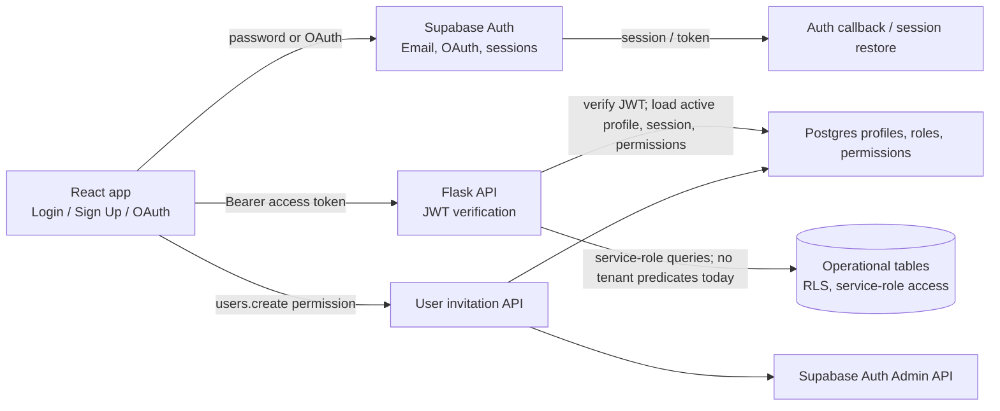

# NetOps360 Company Authentication Audit

**Review date:** 2026-11-27  
**Scope:** Supabase Auth, Flask JWT/RBAC, company onboarding, invitations, database access, and frontend auth flow.  
**Change boundary:** Documentation only. No auth implementation or database structure was changed during this audit.

## Executive findings

The repository already has a usable Supabase Auth and Flask authorization foundation: browser sessions use Supabase Auth, Flask verifies bearer JWTs, role permissions are loaded from Postgres, and protected API routes check permissions. The login page includes email/password and Google, GitHub, and Microsoft provider buttons; a separate email/password company sign-up page exists.

The current system is **not ready for isolated company accounts**. It has no company entity or tenant foreign keys. `company_name` is only profile text, all operational records are global, the Flask repository uses the service-role client, and existing RLS has no tenant policies. A Company Admin permission check therefore does not restrict the records or users that administrator can access.

Open self-registration also creates global roles: the first provisioned identity receives `super_admin`, while subsequent email identities can receive `admin`. OAuth identities can be provisioned as `viewer` without completing company registration. No database uniqueness rule prevents multiple independent registrations for the same company. These are the highest-priority design gaps.

**Recommendation:** retain Supabase Auth and the current Flask JWT/RBAC boundary, but gate protected access behind a database-atomic company claim or invitation acceptance. Introduce stable company IDs and tenant ownership across all company data before enabling company registration in production. Keep global Super Admin creation as a separate, operator-controlled bootstrap path.

## Current authentication architecture



### Current behavior by component

- **Supabase client and session:** [supabaseClient.js](../frontend/src/services/supabaseClient.js) uses the publishable key, persists the session in `sessionStorage`, detects OAuth links, and refreshes tokens. [AuthContext.jsx](../frontend/src/context/AuthContext.jsx) restores identity through `/api/auth/me` and clears the local session when the API rejects it.
- **Email/password:** [Login.jsx](../frontend/src/pages/Login.jsx) signs in through Supabase. [SignUp.jsx](../frontend/src/pages/SignUp.jsx) collects name, email, password, and company name. `signUpCompany` puts name/company in user metadata and calls `/api/auth/onboard-company` only when Supabase immediately returns a session. When email confirmation is required, company provisioning happens later during authenticated identity loading.
- **OAuth:** login offers Google, GitHub, and Azure/Microsoft through Supabase. The shared callback restores a session, but there is no company-name collection step in the OAuth path. A new OAuth identity can be provisioned by `/api/auth/me` with no company name and the Viewer default role.
- **Flask authentication:** [auth.py](../backend/app/utils/auth.py) verifies ES256/RS256 through Supabase JWKS; legacy HS256 tokens are validated by calling Supabase Auth. It checks issuer, audience, expiry, UUID subject/session, anonymous status, active profile, revoked session, and then loads permissions from Postgres. The service-role key stays backend-side.
- **RBAC and user administration:** user and role endpoints require permission decorators. Role assignment is bounded by the actor's permission set and the SQL migration guards removal of the last active Super Admin. Invitation and suspension use the Supabase Auth Admin API. Frontend permission checks hide navigation/actions, while Flask remains the actual authorization boundary.
- **Invitations:** Company Admin is inferred from the global `admin` role. The latest migration reserves one assistant invite per normalized company-name string and records `invited_by`; accepted invite profiles receive the invited role. The profile is currently set active immediately after the invitation is sent, before the invitee accepts it.
- **Protected routes:** React protects the application shell and filters navigation by permission. These are usability protections; direct API calls are still controlled by Flask. Public routes include login, sign-up, OAuth callback, recovery, and invitation acceptance.
- **Database/RLS:** auth tables and operational tables have RLS enabled with no public/authenticated policies. The backend's single Supabase service-role client bypasses RLS. No tenant predicates or company foreign keys exist on operational rows, so this is not tenant isolation.

## Audit findings

### P0 — Tenant data is not isolated

There is no `companies` table or stable `company_id` in `profiles`, `devices`, `monitoring_logs`, `rules`, `incidents`, `config_backups`, or `automation_logs`. User and operational list/detail/update APIs query globally by resource ID or generic filters. The role check answers “may this user read incidents?” but not “may this user read this company's incidents?”. Because Flask uses the service-role key, the current no-policy RLS setup does not provide a second tenant boundary.

**Impact:** once more than one company uses the service, company users can access or modify other companies' records through authorized endpoints. This blocks the required isolation of users, devices, incidents, backups, monitoring, and automation records.

### P0 — Public onboarding provisions global admin authority

`provision_auth_profile` grants `super_admin` to the first identity globally if no Super Admin role assignment exists. Otherwise its caller-selected default role is assigned. Email registration/onboarding passes `admin`; the admin permission set includes operational writes, user management, suspension, and role assignment. OAuth provisioning passes `viewer`, but no company registration is required before that account is active. These are global roles, not company-scoped roles.

**Impact:** public sign-up can determine the first global Super Admin, and later email sign-ups become global administrators. This does not implement “one initial Company Admin per company” and creates an untrusted bootstrap path.

### P1 — Company name is metadata, not a unique company identity

`profiles.company_name` and `company_assistant_invite_reservations.company_name` are text fields. There is no uniqueness constraint or atomic company-registration claim. `onboard_company` prevents only a case-sensitive rename when the current profile already has a value; it does not reject a name already used by another company, and an identity with no company can claim any name. The provisioning RPC can also update an existing profile's company name from supplied metadata.

**Impact:** duplicate independent registrations are possible; company name casing/spelling can create separate identities; metadata or onboarding can reassign an unclaimed profile. A display name should never be the authorization key.

### P1 — OAuth does not satisfy mandatory company registration

The OAuth buttons are on Login, and callback/session restoration immediately calls `/api/auth/me`. That endpoint provisions missing identities. There is no OAuth company form or pending-onboarding gate, so new social users can become active with no company and a Viewer role. The company-name requirement is only present in the email sign-up form.

### P1 — Invitations and user administration are not company-scoped

`/api/users`, user detail, status, role assignment, and audit-history operations have global permission checks only. A user with `users.read` or `roles.assign` can operate on arbitrary user IDs. Invitation limit logic keys on a company-name string and role, not a company ID. Invitation profiles become active before the recipient accepts the Supabase invite.

**Impact:** Company Admins cannot be safely delegated until target users and role operations are constrained to the actor's company and invite acceptance is represented as pending membership.

### P2 — Frontend onboarding and role UX can mislead

Sign Up is always linked on Login, but its form only covers email/password. OAuth is presented as sign-in, without an explicit “new user must complete company registration” transition. `AuthCallback` routes any authenticated user to `/`; it does not route unregistered identities into onboarding. Frontend route guards are permission-aware for navigation but do not replace tenant-scoped API authorization.

### P2 — Migration state and live behavior are unverified

The repository has an additive company-onboarding migration, but no live Supabase project was available during this audit. Whether the migrations have been applied, whether current data contains duplicate company names, and whether Auth provider/SMTP/redirect settings work cannot be confirmed from source alone. Do not infer database state from migration files.

## Proposed registration and onboarding flow

```mermaid
sequenceDiagram
  actor U as User
  participant UI as React app
  participant SA as Supabase Auth
  participant API as Flask API
  participant DB as Postgres

  U->>UI: Choose email/password or Google/GitHub/Microsoft
  UI->>SA: Create/authenticate identity
  SA-->>UI: Session and verified identity (after required verification)
  UI->>API: Complete onboarding with company details or invitation token
  API->>API: Verify JWT; ignore user_metadata for authority
  API->>DB: Atomic company claim or consume invitation
  DB->>DB: Enforce unique company key and one initial Company Admin
  DB-->>API: Company membership and scoped role
  API-->>UI: Active profile, company ID, permissions
  UI->>UI: Enter protected app
```

1. Keep **Sign Up** visible on the login page. Provide email/password and the configured social providers from one registration entry point.
2. After any provider authenticates a new identity, require the same company onboarding form before granting operational access. Email verification should complete before the company claim is finalized. Until then, the profile remains `pending_onboarding` (or equivalent) and protected API access is denied.
3. The backend validates company fields and claims the company in one database transaction/RPC. A unique normalized legal identifier is the preferred duplicate key. If the product only collects a company name, define and disclose normalized-name uniqueness and its limitations; names alone cannot reliably identify legal entities.
4. The first successful claim creates one Company Admin membership atomically. Global Super Admin is provisioned only through a separate operator-controlled bootstrap process, never as the first public registrant.
5. Later users do not claim/create companies. A Company Admin issues an invitation tied to `company_id` and an allowed company-scoped role. Invitation acceptance must match the invited email, consume the invitation once, create membership atomically, and then activate the account.
6. Flask derives `company_id` from the verified profile/membership on every request. It rejects caller-supplied tenant IDs that do not match authorization and scopes resource reads, writes, joins, background jobs, and audit records. Add database RLS as defense in depth where practical; do not rely on frontend checks or user-editable metadata.

## Database migration plan

This is a plan only; no production schema changes are authorized or made by this audit.

### Phase 0 — Inventory and compatibility preparation

- Confirm migration history and deployed schema in a non-production Supabase project.
- Export/profile current users and count normalized company names, null company names, role assignments, unaccepted invites, and orphaned operational rows.
- Decide the authoritative duplicate-company key (verified registration identifier/domain versus normalized name), Super Admin policy, and whether each user can belong to exactly one company.
- Map existing global data to an explicit legacy/default tenant or approved company ownership. Do not silently assign shared records to the first company.

### Phase 1 — Additive company identity and memberships

- Add `companies` with immutable UUID, display name, normalized unique business key, status, and timestamps.
- Add `company_id` to profiles and create an explicit company membership model (or a constrained one-company-per-profile relation); keep global Super Admin outside tenant roles.
- Add unique constraints for the company key and one initial Company Admin membership per company. Use a transactional provisioning function with a fixed `search_path`, least-privilege grants, input validation, and concurrency control.
- Add invitation rows with company ID, normalized email, scoped role, expiry, accepted/revoked state, and unique single-use token hash. Retire or migrate the current name-based reservation table after preserving outstanding invitations.

### Phase 2 — Tenant ownership on operational data

- Add nullable `company_id` columns first to devices, rules, monitoring logs, incidents, config backups, automation logs, and any company-owned audit records.
- Backfill only from an approved ownership map; preserve unresolved rows in a quarantined/unassigned state that is not visible to company users.
- Add foreign keys, tenant-aware indexes, and constraints. Make ownership non-null after the backfill is reconciled.
- Ensure child rows inherit and validate the same company as their device/incident (for example, backup.device.company_id and automation incident/device consistency).

### Phase 3 — Enforce and roll out

- Deploy Flask repository/service tenant filters and tenant-aware authorization before enabling tenant accounts.
- Add RLS policies based on trusted membership claims or a safe membership lookup; keep service-role use behind the Flask boundary and add explicit tenant predicates even when RLS is enabled.
- Add cross-tenant negative integration tests for list/detail/update/delete, search, pagination, nested references, reports, automation, background monitoring, and sensitive backup detail.
- Use an expand/backfill/verify/enforce rollout. Measure every company/resource count, retain rollback data, and only then enforce `NOT NULL`/RLS and open registration.

## Existing components to reuse

- Supabase Auth and the existing `supabase-js` client, including email/password, OAuth, session refresh, recovery, and callback handling.
- Flask JWT verification, active-account checks, revoked-session handling, permission decorators, audit logging, and server-only service-role client.
- `AuthContext`, login/sign-up pages, `AuthCallback`, `AcceptInvite`, and API bearer-token forwarding; extend them with an explicit onboarding state instead of replacing them.
- `AuthService`, `UserService`, `provision_auth_profile`, the role/permission catalogue, Supabase repository RPC boundary, and the existing invite workflow, after adding company-aware validation and membership semantics.
- Existing additive migrations and migration documentation. Build new company migrations after verifying deployed state; do not edit/rewrite applied migrations.
- Existing test doubles and auth/invitation tests; add company claim races, OAuth onboarding, cross-tenant access-denial, invite acceptance, and company admin boundary cases.

## Prioritized security gaps

| Priority | Gap | Required closure before multi-company production |
|---|---|---|
| P0 | No tenant IDs or tenant filters for any operational/user data | Company ownership FKs, scoped repository methods, RLS defense in depth, cross-tenant denial tests |
| P0 | Public identity provisioning can grant global Super Admin/Admin | Separate global bootstrap; public users receive no operational role until atomic company claim or invite acceptance |
| P1 | Duplicate company registration not prevented atomically | Unique stable company key and transactional claim; no metadata-based authority |
| P1 | OAuth can create an active user without required company onboarding | Shared onboarding gate after every provider; pending state denied by Flask |
| P1 | User, status, role, invitation, and audit APIs are not tenant-scoped | Constrain both actor and target membership to the same company; enforce on the server and database |
| P1 | Invite status is active before invite acceptance | Persist pending invite/membership; activate only after verified, single-use acceptance |
| P2 | `company_name` from user metadata can update profile company text | Treat metadata as untrusted display hints only; derive tenant from a server-created company membership |
| P2 | Existing migration application/data state and provider configuration unknown | Verify in staging, reconcile data, and test email/OAuth callbacks before rollout |

## Evidence and limits

This is a source and migration review, not a live Supabase security assessment. The repository contains tests for JWT/RBAC, first-identity provisioning, OAuth Viewer provisioning, company-name onboarding, and invitation limits. Those tests use an in-memory repository/fakes; the existing auth test report states that five Supabase integration tests require credentials and were skipped. No live database, Auth dashboard settings, provider credentials, or production migration history was inspected for this document.

The recommended next step is to review this architecture and migration plan, then authorize implementation as a separate, staged change. Until tenant ownership and server-side scoping exist, public company registration should not be treated as production-ready for multiple companies.
